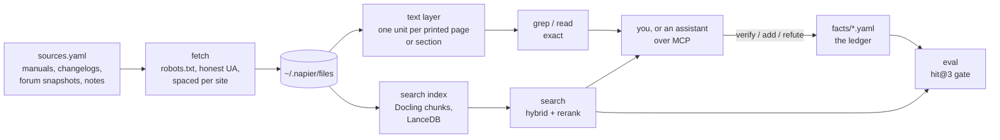

# How napier works

## Fetching

napier only downloads the URLs in its source lists, one request at a time.

- Before its first request to a site in each run, it reads that site's robots.txt and follows it,
  including `Crawl-delay`. Following RFC 9309, a missing robots.txt (4xx) allows everything, and one
  that can't be reached (5xx or no connection) blocks the site until it can be read.
- It identifies itself as
  `napier/<version> (+https://github.com/bvk7787/napier; fetches each listed document once per run)`.
- Requests to the same site are at least 2 seconds apart. On a 429 or 503 it waits as long as
  Retry-After says (30 seconds if there's no header) and gives up after three tries, or right away
  if asked to wait more than five minutes.
- Redirects are followed only to public http(s) addresses that robots.txt also allows. `file://`
  URLs and private or local network addresses are refused. It doesn't crawl links or log in.
- Each response is capped at 300 MB and 10 minutes.

Forum threads (fetched through Discourse's public `/raw` pages) and pinned code are snapshots
(`check: false`), fetched once. Shared docs that people keep editing, like the M8 community tips,
get re-checked like changelogs.

## The text layer

`napier ingest --text-only` splits each source into units, one per PDF page or one per section for
web pages and text files. `grep` and `read` work on these directly without any model. PDF text comes
from the PDF's own text layer through pypdfium2. With the `index` extra installed, napier also keeps
Docling's markdown version, which reads better for tables and headings.

Each PDF has a `page_offset` (printed page = PDF page - offset), detected from the page footers and
headers when the source is added. Front matter before the numbering starts shows up as `PDF p. N`.

## Search

With the `index` extra, `napier ingest` parses PDFs with Docling, chunks them with Docling's
HybridChunker, embeds the chunks and stores them in LanceDB with a full-text index. A query collects
vector and BM25 candidates, merges them with reciprocal rank fusion, and reranks them with a
cross-encoder.

| Model | Role | Pinned commit |
|---|---|---|
| `Snowflake/snowflake-arctic-embed-l-v2.0` | embeddings | `ac6544c8a46e00af67e330e85a9028c66b8cfd9a` |
| `BAAI/bge-reranker-v2-m3` | reranking | `953dc6f6f85a1b2dbfca4c34a2796e7dde08d41e` |

The models load at those commits, so an upstream update can't quietly change your results. Docling
downloads its own layout models the first time it runs.

## The eval

Every public fact has `q` (a question) and `anchors` (short phrases quoted from its page), so each
one doubles as a search test. `napier eval` asks each question, filtered to the fact's device and
its source's kind, and counts a hit when a result contains every anchor (or one of the fact's `alt`
anchor sets). It reports hit@1, hit@3 and whether the matching result is on the cited page, and
exits non-zero below 90% hit@3 (`--min-hit3` changes that). Contributors write the questions knowing
the answers, so the eval is best at catching regressions. It says less about how search handles
other phrasings.

## What it writes, and where

| What | Where, by default | Moved by |
|---|---|---|
| Downloaded sources, parse cache, text layer, search index, reports | `~/.napier` | `$NAPIER_HOME` |
| Search models (with the `index` extra) | `~/.cache/huggingface` | `$HF_HOME` |
| Your overlay | `local/` in the clone | `$NAPIER_LOCAL` |
| Sources, facts and specs you add | the clone's YAML files, or the overlay's | |
| `rack view` page | `~/.napier/rack-view.html` | `--out` |

`src/napier/paths.py` documents every folder and the environment variables that move them.

Besides fetching sources, napier only uses the network in these cases:

- With the `index` extra, the first `ingest` downloads the embedding and layout models from Hugging
  Face, and the first `search` downloads the reranker.
- A `github_releases` source sends `$GITHUB_TOKEN` to api.github.com, if you've set one.
- `refresh` talks to a local Ollama server if you use one, and to GitHub through `gh` when it opens
  a pull request.
- `rack view --web-fonts` loads fonts from Google Fonts.
- A rack-source plug-in you install may fetch during `rack sync`.

There's no telemetry.
