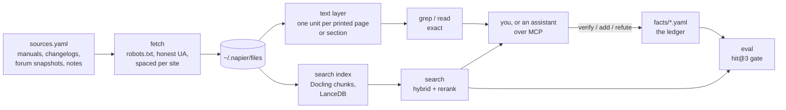

# How napier works

## Fetching

napier downloads only the URLs in its source lists, one request at a time:

- It reads each site's robots.txt before its first request to that site in a run and follows it,
  including `Crawl-delay`. A robots.txt that's missing (4xx) allows everything; one that can't be
  reached (5xx, or no connection) disallows everything until it can be read, as RFC 9309 says.
- It identifies itself as `napier/<version> (+https://github.com/bvk7787/napier; fetches each listed
  document once per run)`.
- Requests to one site are at least 2 seconds apart. On 429 or 503 it backs off, honoring
  Retry-After (seconds or a date; 30 seconds when there's none), and gives up after three tries. A
  request that's asked to wait more than five minutes fails for this run.
- It follows HTTP redirects only to public http(s) addresses that robots.txt also allows. It never
  crawls links, never logs in, and refuses `file://` URLs and private or local network addresses.
- One response is capped at 300 MB and 10 minutes.

Forum threads (through Discourse's public `/raw` pages) and pinned code are `check: false`
snapshots: fetched once, never polled. A shared document that its authors keep updating, like a
community tips doc, is re-checked like a changelog.

## The text layer

`napier ingest --text-only` turns each source into units: one per PDF page, or one per section for
web pages and text. `grep` and `read` work on these directly, with no model. For PDFs the text comes
from the PDF's own text layer (pypdfium2); with the `index` extra installed, Docling's markdown is
kept too, which reads better for tables and headings.

**Printed pages.** Each PDF source has a `page_offset` (printed page = PDF page - offset), detected
from page footers and headers when the source is added. Front matter before the numbering starts shows as
`PDF p. N`.

## Search

`napier ingest` (with the `index` extra) parses PDFs with Docling, chunks them with Docling's
HybridChunker, embeds the chunks and stores them in LanceDB with a full-text index. A query gathers
vector and BM25 candidates, fuses them with reciprocal rank fusion, and reranks the pool with a
cross-encoder.

| Model | Role | Pinned commit |
|---|---|---|
| `Snowflake/snowflake-arctic-embed-l-v2.0` | embeddings | `ac6544c8a46e00af67e330e85a9028c66b8cfd9a` |
| `BAAI/bge-reranker-v2-m3` | reranking | `953dc6f6f85a1b2dbfca4c34a2796e7dde08d41e` |

Models load at those commits, so an upstream change can't silently change results. Docling
downloads its own layout models on first use.

**Kinds stay separate.** `manual`, `changelog`, `community`, `code` and `note`: search and grep can
filter by kind, and every result says which it is, so a forum workaround never passes for the
manual.

## The eval

A fact with `q` (a question) and `anchors` (short phrases quoted from its page) is a search test.
`napier eval` asks each question, filtered to the fact's device and the kind of its source, and
counts a hit when one result holds every anchor (or one of the fact's `alt` anchor sets). It reports
hit@1 and hit@3 and whether the matching hit is on the cited page, and exits non-zero below 90% hit@3
(`--min-hit3` changes the gate). The questions are written by contributors who know the answer, so
the eval guards against regressions on them; it says less about questions phrased some other way.

## What it writes, and where

| What | Where, by default | Moved by |
|---|---|---|
| Downloaded sources, parse cache, text layer, search index, reports | `~/.napier` | `$NAPIER_HOME` |
| Search models (with the `index` extra) | `~/.cache/huggingface` | `$HF_HOME` |
| Your overlay | `local/` in the clone | `$NAPIER_LOCAL` |
| Sources, facts and specs you add | the clone's YAML files, or the overlay's | |
| `rack view` page | `~/.napier/rack-view.html` | `--out` |

`src/napier/paths.py` documents every folder and the environment variables that move them.

Network use beyond fetching sources: with the `index` extra, the first `ingest` downloads the
embedding and layout models from Hugging Face and the first `search` the reranker; a
`github_releases` source sends `$GITHUB_TOKEN`, if you've set it, to api.github.com; `refresh` talks
to a local Ollama server if you use it, and to GitHub through `gh` when it opens a pull request;
`rack view --web-fonts` loads fonts from Google Fonts; and a rack-source plug-in you install may
fetch during `rack sync`. Nothing else, and no telemetry.
